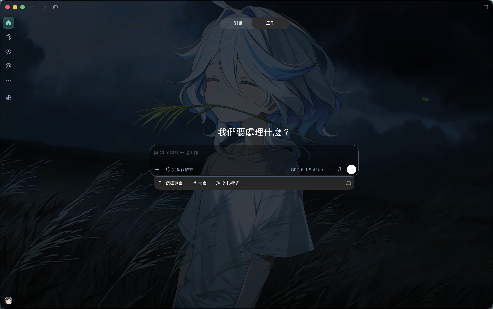
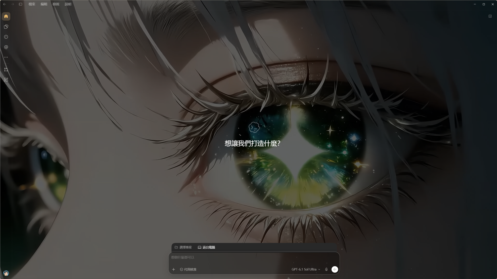
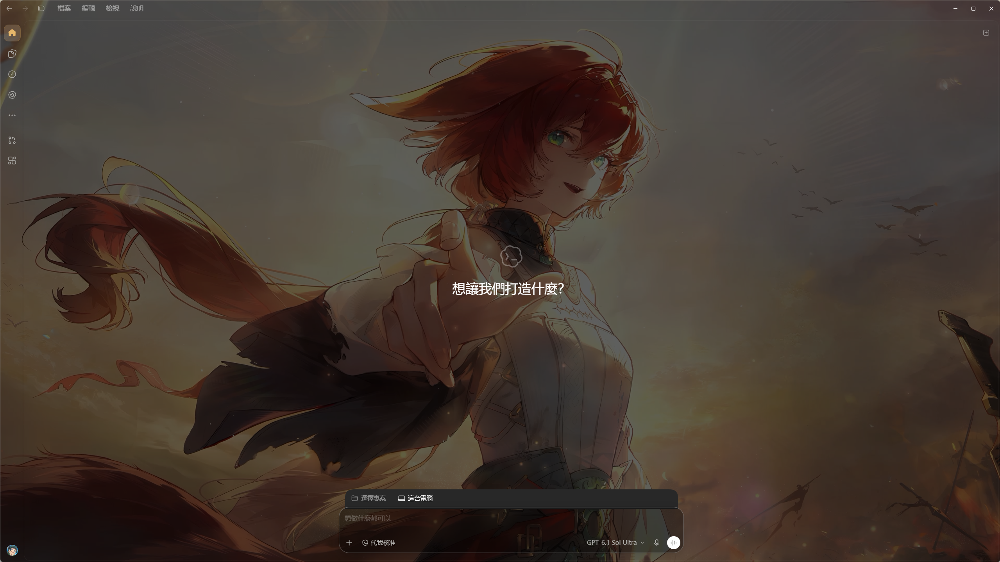
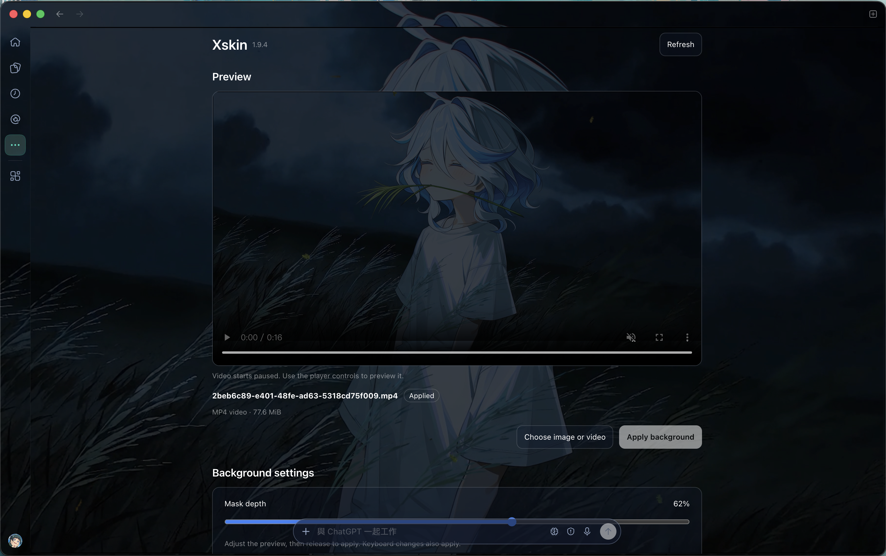
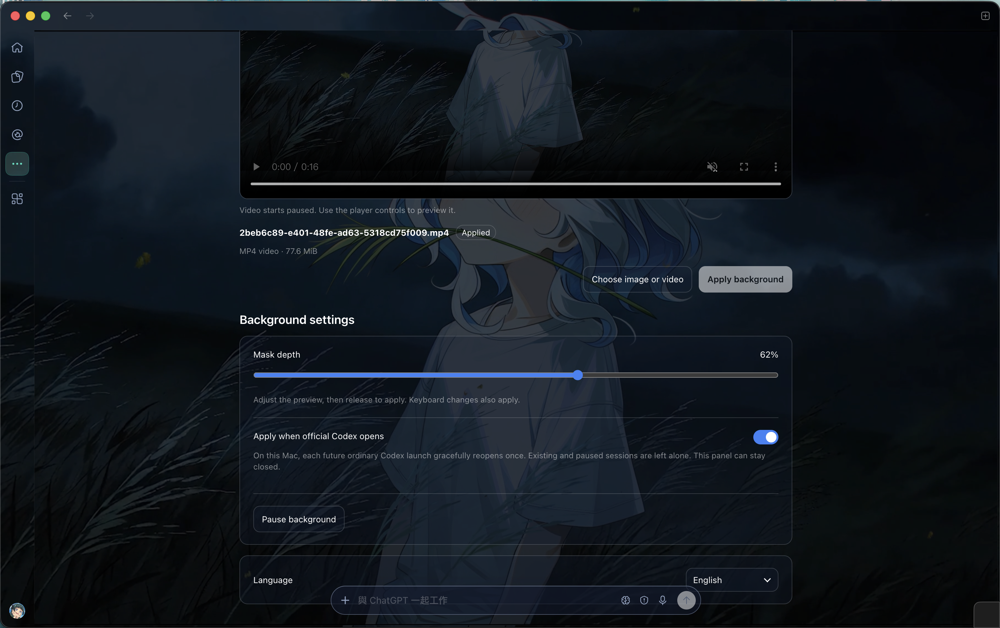
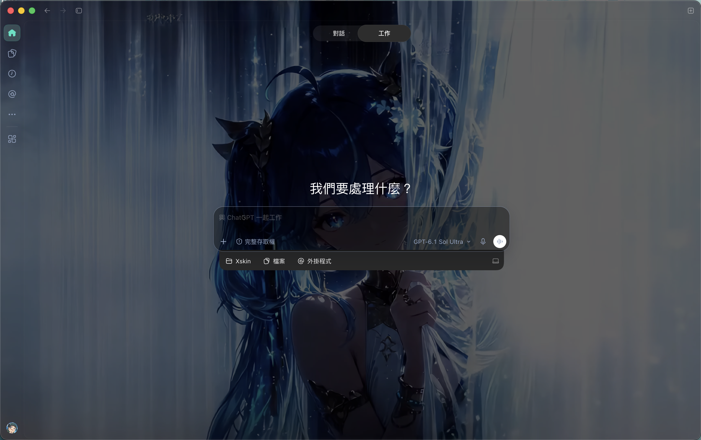
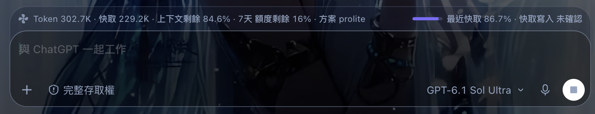

<div align="center">

# Xskin

### Make Codex feel like your workspace.

Bring your favorite images and original 4K videos into Codex.<br>
Import, preview, and apply inside Codex on macOS and Windows, or use the standalone apps.

[](https://github.com/timmyc07/Xskin/releases/tag/v1.9.6)
[](https://github.com/timmyc07/Xskin/releases/tag/windows-v1.9.6)


[](macos/LICENSE)

**[Windows standalone](https://github.com/timmyc07/Xskin/releases/download/windows-v1.9.6/Xskin-1.9.6-windows-x64.zip)** · **[Windows Codex plugin](https://github.com/timmyc07/Xskin/releases/download/windows-v1.9.6/xskin-plugin-v1.9.6-windows-x64.zip)** · **[macOS standalone](https://github.com/timmyc07/Xskin/releases/download/v1.9.6/Xskin-v1.9.6-macos-arm64.zip)** · **[macOS Codex plugin](https://github.com/timmyc07/Xskin/releases/download/v1.9.6/xskin-plugin-v1.9.6.zip)**

[Windows SHA-256 checksums](https://github.com/timmyc07/Xskin/releases/tag/windows-v1.9.6#release-assets) · [Report an issue](https://github.com/timmyc07/Xskin/issues)

English by default · Traditional Chinese · Simplified Chinese · Japanese

> **Windows 1.9.6 · macOS 1.9.6.** Manage backgrounds inside Codex through **More → Xskin**, or use the standalone app. Download the plugin for your platform. See [installation and validation](docs/in-app-studio.md).

[Windows guide](windows/README.md) · [macOS guide](docs/background-panel.md) · [Windows performance measurements](windows/references/performance.md)

</div>

## Install with your AI

On Windows, copy this prompt into an AI coding assistant that can run local commands. It installs both packages; no Flutter, npm or separate Node installation is needed. [繁體中文安裝提示詞](windows/CLIENT_DEPLOY_PROMPT.md)

```text
Install Xskin 1.9.6 on this Windows x64 computer, including BOTH the standalone app and the in-Codex plugin. Complete the installation, not just instructions.

Use only https://github.com/timmyc07/Xskin/releases/tag/windows-v1.9.6 . Download Xskin-1.9.6-windows-x64.zip and xskin-plugin-v1.9.6-windows-x64.zip, plus each matching .zip.sha256 file. Verify both SHA-256 hashes before running anything; stop on a mismatch. Read the packaged Windows README and preserve all existing Xskin media, preferences and unrelated Codex settings.

Extract each complete ZIP into a separate persistent user-owned folder, keeping every adjacent file. Find the standalone root containing xskin.exe and run its Install Xskin.exe. Find the plugin root containing plugin.json, mcp.json and .agents/plugins/marketplace.json. Use the official Codex CLI (locate it in the installed OpenAI.Codex Store package if it is not on PATH). Check its plugin command help, then run:
codex plugin marketplace add "<absolute extracted plugin root>"
codex plugin add codex-background-studio@codex-background-studio-local

Verify the standalone version and that the plugin is installed and enabled as 1.9.6. Preserve the current Codex session; if a host reload is needed, report that step without force-quitting it. Keep the installer's defaults and existing startup preferences. Do not replace official app files, change credentials/API keys/Base URLs or select a new background without my request. Report installed paths, versions and any remaining step.
```



*An applied video background on Codex Home for macOS. Screenshots in this README were provided by the maintainer; they are interface examples, not bundled wallpapers.*

## Windows in action

Windows Codex Home with two different backgrounds, showing the full-window appearance, native window controls, navigation and translucent input. Download Windows 1.9.6 above and follow the [Windows guide](windows/README.md).

| Eye close-up background | Sunset character background |
| --- | --- |
|  |  |

*Maintainer-provided Windows screenshots. The pictured background media are not bundled with Xskin.*

## Your media. Your atmosphere.

A quiet photograph. A moving landscape. A workspace that feels a little more like you. Xskin brings your chosen media into Codex while keeping the familiar conversations, projects, and controls at the center of your work.

| Choose your scene | See it before you apply | Feel at home | Keep your setup |
| --- | --- | --- | --- |
| Import local images and MP4s, including original 4K video. | Check the composition, filename, media type, and file size before applying. | Choose files and control video previews inside Codex on macOS and Windows; standalone apps also support drag and drop. | Keep your background, mask depth, pending import, and language preference locally. |

## Preview and tune inside Codex

Open **More → Xskin** with the matching macOS or Windows plugin to choose media, preview it, and manage the saved background in one panel.

| Preview and apply | Background settings |
| --- | --- |
|  |  |
| Select **Choose image or video**, play the paused preview when needed, then select **Apply background**. | Adjust **Mask depth**, enable **Apply when official Codex opens**, pause the background, or choose your interface language. |

The panel shares saved media and preferences with the standalone app on the same platform. Choosing a file only prepares a preview; it replaces the current background after a successful Apply. The applied background also stays visible behind the Xskin panel.



*A different background style with the same Codex workspace controls.*

## From media to workspace in three steps

1. **Import** an image or MP4 with the file picker. The standalone macOS and Windows apps also accept drag and drop.
2. **Preview** the composition, filename, media type, and file size. Video starts paused; use the player controls to play it. Importing does not replace the current background.
3. **Apply** when you are ready. Xskin checks the result, restores the previous configuration if applying fails, and retains the import for retry.

- **Windows:** extract the complete standalone ZIP and open **Install Xskin.exe** or **xskin.exe**. Keep the accompanying DLLs, `data`, `scripts` and `assets` together. For **More → Xskin**, also install the [Windows Codex plugin](windows/README.en.md#embedded-studio). Flutter and Node.js are bundled.
- **macOS:** install the [Codex plugin](docs/in-app-studio.md#install-or-update-locally), then open **More → Xskin** inside Codex. The standalone **Xskin.app** remains available; move it to Applications to use it. Packaged users need no separate Node.js, package manager or Xcode.

If the macOS panel reports **No background connection is available**, enable **Apply when official Codex opens**, fully quit Codex, then reopen the official app. That fresh launch gracefully reopens once to establish the background connection. Return to Xskin and apply your pending selection. Opening the panel alone does not enable automatic startup. See [first-use connection requirements](docs/in-app-studio.md#applying-without-interrupting-the-current-app).

> The macOS app uses an ad-hoc signature and has not been notarized with Apple Developer ID. macOS may show a source verification warning. Download from this project's Release page and review the [user guide](docs/background-panel.md).

## Details that make room for your work

### Keep 4K in its original form

MP4 files retain their original bytes, resolution, and frame rate. There is no re-encoding or forced conversion to 1080p. If your source is 4K, Xskin uses that same 4K media.

### Set the balance between atmosphere and readability

Muted, looping video, a full-window black mask, and a transparent sidebar create one continuous background. Codex conversations, projects, and input controls remain interactive.

One **mask-depth slider** adjusts all surfaces together from **0–100%**, with a **62% default**. The preview updates while dragging; release the slider to apply automatically. Keyboard adjustments also apply, and the value persists locally. The mask changes the visual overlay without modifying the image or video.

### Use the language that works for you

Xskin opens in **English** by default. Switch the interface to **Traditional Chinese**, **Simplified Chinese**, or **Japanese** inside the app. Your choice is remembered for the next session.

### Let playback follow your attention

Video preview starts paused so you can inspect it when needed. Background playback pauses when the Codex window is hidden or system Reduce Motion is enabled, avoiding playback you are not watching.

### Pick up where you left off

macOS 1.9.6 keeps the **official Codex app** as its normal entry: an enabled background service gracefully reopens each new ordinary launch once to apply the saved background and overlay. Xskin can stay closed. The optional `~/Applications/Codex (Xskin).app` starts directly with the background connection and avoids that reopen. Opening the embedded panel alone does not enable automatic startup; Apply and mask changes require an existing verified background connection.

Windows 1.9.6 includes the same embedded studio, retained original-media previews, recovery and six presets, plus watcher reuse during Apply and hidden Dot video verification fixes. Explicitly enable **Apply when official Codex opens** to start the per-user login monitor; future fresh ordinary launches gracefully reopen once. Existing, paused and debugging sessions are skipped. Codex (Xskin) remains the direct-launch option. See [Windows parity and validation](docs/windows-parity.md).

### Leave room around the input



The conversation usage strip sits **above the input**, wraps in narrow windows and stays hidden on Home. It shows total and cached tokens, context remaining, reported quota and plan, and the latest input's cache hit rate when available. The input and native project/files/plugins toolbar share translucent surfaces that reveal your background while keeping the controls clear. The fan stops when the task finishes or is interrupted.

*The screenshot's numbers are examples from one conversation. The plan is the latest report in that conversation, not live account status. Missing plans show “not provided”; source-reported zero cache writes show “unconfirmed”. Missing measurements are never filled with zero.* See [field meanings, sources, and limits](docs/usage-fields.md).

### Keep streaming updates light

The usage reader processes new history incrementally, and Windows avoids full-page route scans for ordinary message updates. MP4 integrity checks use bounded buffers while retaining the original video. Measured reader I/O, theme-load CPU/memory, and playback results are documented in the [usage report](docs/usage-fields.md#validation) and [Windows performance report](windows/references/performance.md). These measurements do not establish lower sustained GPU use or playback memory.

## Supported media

| Type | Formats | File limit | Processing |
| --- | --- | --- | --- |
| Images | JPG, PNG, WebP, HEIC, TIFF | 50 MiB | Converted to JPEG, up to 4096 pixels on the longest edge. Smaller images are not enlarged. |
| Video | MP4; H.264 recommended | 256 MiB | Original file preserved without re-encoding, including 4K sources. |

Imports create local copies and leave source files intact. MP4 is a container format; playback depends on the video codec and system decoder support.

## Your media stays on your computer

- **Local media processing.** Xskin does not upload imported images or videos to the cloud.
- **No additional account.** It does not ask for an OpenAI API key or change Codex account credentials, API keys, or model provider settings.
- **Official app files remain intact.** The background engine applies appearance changes through a local connection without modifying the official app bundle or its code signature.
- **An implementation you can inspect.** macOS uses SwiftUI/AppKit/AVKit and the verified Node runtime bundled with Codex. Windows uses Flutter/media_kit and includes its own Node runtime. Neither panel needs an HTTP server.

The debugging connection binds only to the loopback address. Xskin remains an external customization tool: download it from trusted sources and avoid running untrusted local programs.

## Requirements and practical limits

| Item | Requirement |
| --- | --- |
| Operating system | Windows 11 x64 (tested on 24H2), or macOS 13+ |
| Processor | Windows x64 or Apple Silicon; no Intel Mac prebuilt binary |
| Required software | Official Codex Desktop; Windows uses the registered Microsoft Store `OpenAI.Codex` package |
| Installation | macOS: install the Codex plugin, or move Xskin.app to Applications. Windows: extract the complete standalone ZIP and run Install Xskin.exe; install the separate Windows plugin for the in-Codex panel. |
| In-Codex panel | macOS and Windows local execution; use the matching platform plugin package |
| Interface languages | English, Traditional Chinese, Simplified Chinese, and Japanese |

- Releases are platform-specific: **windows-v1.9.6** for Windows x64 standalone/plugin and **v1.9.6** for macOS arm64/plugin. The Windows app is unsigned; use the project's official Release files and verify their SHA-256 checksums.
- Both platforms support the optional Codex (Xskin) direct entry and an explicitly enabled official-app entry with one graceful reopen per fresh launch.
- Automated macOS tests and Windows runner/Flutter checks passed. Three physical cold starts, login/Store-update checks and complete official-app Home/task visual inspection remain pending; see the [validation report](docs/platforms.md#2026-10-23-overlay-layout-validation). CDP/CSS authorization remains unconfirmed.
- A cold start still needs application loading and media decoding. Startup time depends on app state, media, and hardware; no fixed latency is guaranteed. See the [measured startup results](docs/startup-verification.md).
- Codex updates may change the interface or launch behavior and affect background application. Disable automatic apply and report version details if problems occur.
- 4K decoding and playback load depend on frame rate, codec, and hardware. Preserving original quality does not guarantee identical resource use across files.
- Xskin is an independent open-source project, with no official affiliation with or endorsement from OpenAI or Apple.

## Upgrade or restore

Download the new package into a separate folder. Close the Xskin panel, replace Xskin.app on macOS or run **Install Xskin.exe** on Windows, then open Xskin. Engine updates preserve the running official app, saved media, language, mask and pause preferences; failed replacements restore the previous engine. Keep your old package until the update is working.

Use **Pause** to stop the skin without deleting it, and **Apply/Resume** to enable it again. To roll back, disable automatic backgrounds, close Xskin and reinstall the saved package without deleting its data directory. **Restore/Uninstall** removes only owned entry points and retains saved media/preferences. See [platform migration and recovery](docs/direct-launch-shortcut.md#install-and-restore) for paths and full appearance restoration.

<details>
<summary><strong>Build and contribute</strong></summary>

Source builds require macOS and Xcode Command Line Tools. The native interface is in [`macos/native/Xskin.swift`](macos/native/Xskin.swift); the background engine is in [`macos/scripts/`](macos/scripts/).

For Windows, see the [Flutter build instructions](windows/README.md#建置與測試). `windows/scripts/build-release.ps1` runs engine tests, Flutter analysis/tests and the release build, then produces the ZIP and checksum.

```sh
git clone https://github.com/timmyc07/Xskin.git
cd Xskin
bash macos/scripts/build-native-studio.sh "$PWD/build/Xskin.app"
```

Run the existing macOS checks:

```sh
cd macos
npm test
```

Windows and macOS 1.9.4 support official-app launches through their explicitly enabled service with one graceful reopen; existing/paused sessions are skipped. Codex (Xskin) remains optional. CDP/CSS injection authorization remains unconfirmed; unchanged official files do not establish permission. Include system, Codex and Xskin versions in reports, without private chats, media or credentials.

</details>

## Open source and acknowledgments

Xskin is released under the [MIT License](macos/LICENSE). It builds on [Codex Dream Skin Themes](https://github.com/aithink001/Codex-Dream-Skin-Themes) and [Codex Dream Skin](https://github.com/Fei-Away/Codex-Dream-Skin). Thank you to the upstream contributors for the theme engine and workflows. See [NOTICE](macos/NOTICE.md) for attribution and license details.

Codex, OpenAI, macOS, Apple, and other product names and trademarks belong to their respective owners. Use and share only background media you have the right to use.

---

**Bring your favorite scene into your everyday work.** [Windows →](https://github.com/timmyc07/Xskin/releases/tag/windows-v1.9.6) · [macOS →](https://github.com/timmyc07/Xskin/releases/tag/v1.9.6)
