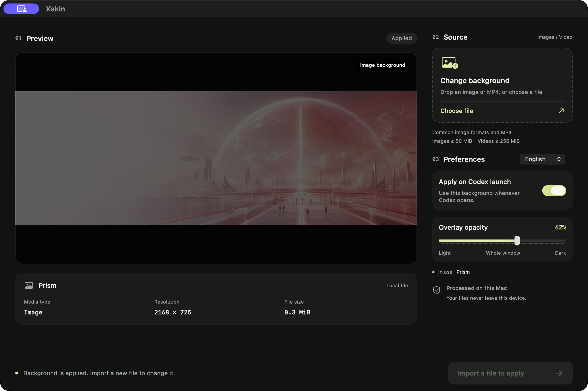

<div align="center">

# Xskin

### Make Codex feel like your workspace.

Bring your favorite images and original 4K videos into Codex.<br>
Import, preview, and apply from native macOS and Flutter Windows apps.

[](https://github.com/timmyc07/Xskin/releases/tag/v1.6.1)
[](https://github.com/timmyc07/Xskin/releases/tag/windows-v1.5.5)


[](macos/LICENSE)

**[Download for Windows x64](https://github.com/timmyc07/Xskin/releases/download/windows-v1.5.5/Xskin-1.5.5-windows-x64.zip)** · **[Download for macOS arm64](https://github.com/timmyc07/Xskin/releases/tag/v1.6.1)** · [Report an issue](https://github.com/timmyc07/Xskin/issues)

English by default · Traditional Chinese · Simplified Chinese · Japanese

[Windows guide](windows/README.md) · [macOS guide](docs/background-panel.md) · [Windows performance measurements](windows/references/performance.md)

</div>



## Your media. Your atmosphere.

A quiet photograph. A moving landscape. A workspace that feels a little more like you. Xskin brings your chosen media into Codex while keeping the familiar conversations, projects, and controls at the center of your work.

| Choose your scene | See it before you apply | Feel at home | Keep your setup |
| --- | --- | --- | --- |
| Import local images and MP4s, including original 4K video. | Check the composition, resolution, and file size before applying. | Use system file selection, drag and drop, and playback controls on either platform. | Keep your background, mask depth, pending import, and language preference locally. |

## From media to workspace in three steps

1. **Import** an image or MP4 with the file picker, or drag one into Xskin.
2. **Preview** the composition and media details. Video starts paused; use the native controls to play it. Importing does not replace the current background.
3. **Apply** when you are ready. Xskin checks the result, restores the previous configuration if applying fails, and retains the import for retry.

- **Windows:** extract the complete ZIP and open **xskin.exe**. Keep the accompanying DLLs, `data`, `scripts` and `assets` together. Flutter and Node.js are bundled.
- **macOS:** extract the app, move **Xskin.app** to Applications, and open it. No separate Node.js, package manager or Xcode is needed.

> v1.6.1 uses an ad-hoc signature and has not been notarized with Apple Developer ID. macOS may show a source verification warning. Download from this project's Release page and review the [user guide](docs/background-panel.md).

## Details that make room for your work

### Keep 4K in its original form

MP4 files retain their original bytes, resolution, and frame rate. There is no re-encoding or forced conversion to 1080p. If your source is 4K, Xskin uses that same 4K media.

### Set the balance between atmosphere and readability

Muted, looping video, a full-window black mask, and a transparent sidebar create one continuous background. Codex conversations, projects, and input controls remain interactive.

One **mask-depth slider** adjusts all surfaces together from **0–100%**, with a **62% default**. The preview updates while dragging; release the slider to apply automatically. Keyboard adjustments also apply, and the value persists locally. The mask changes the visual overlay without modifying the image or video.

### Use the language that works for you

Xskin opens in **English** by default. Switch the interface to **Traditional Chinese**, **Simplified Chinese**, or **Japanese** inside the app. Your choice is remembered for the next session.

### Let playback follow your attention

Video preview starts paused so you can inspect it when needed. Background playback pauses when the Codex window is hidden or system Reduce Motion is enabled, avoiding playback you are not watching.

### Pick up where you left off

Keep your current background and any pending import on your computer. Turn on **Apply on Codex launch** once. On macOS, open the original official Codex app from Finder, Spotlight, or the Dock; the background service gracefully reopens a fresh ordinary launch once to connect your background. On Windows, use **Codex (Xskin)** on Desktop/Start. Xskin does not need to stay open.

On Windows, right-click **Codex (Xskin)** → **Show more options** → **Pin to taskbar**, then unpin the original Codex entry. The shortcut uses the official Codex icon and retains the background launcher. Opening the original Store entry directly does not auto-apply. An already-open ordinary Codex session needs one confirmed restart through manual Apply to enable the background connection.

### Keep streaming updates light

Windows 1.5.2 avoids rescanning the whole page for ordinary message updates. In a controlled 100-update test, route scans fell from **104 to 1** while the original **3840×2160** video kept playing. This measures background-maintenance work, not a 99% reduction in total CPU or GPU use. See the [benchmark and limits](windows/references/performance.md).

**Windows 1.5.3** streams full MP4 integrity checks through a 1 MiB buffer and reuses the video digest. The original video bytes, 4K resolution and frame rate are preserved. Three fresh-process runs of 30 theme loads produced these medians:

| Theme-load measurement | Windows 1.5.2 | Windows 1.5.3 | Reduction |
| --- | ---: | ---: | ---: |
| Process CPU time | 1,344 ms | 843 ms | 37.3% |
| Peak process memory (RSS) | 267.27 MiB | 146.73 MiB | 45.1% |

These are **load-time** improvements included in the **1.5.3 Windows ZIP**. Lower GPU use and sustained playback memory have not been established. See the [resource report](windows/references/performance.md) for playback measurements, reproduction steps and limits.

**Windows 1.5.5** fixes black panel previews when replacing one video with another and adopts macOS 1.6.1 native Work detection and earlier guarded injection. Original video quality and frame rate are retained.

**Windows 1.5.4** includes video backgrounds in the main-window **Your dot** conversation, embedded ChatGPT/Work and Dot floating control cards. The conversation reveals the existing original video and keeps native message bubbles without duplicate full-row panels. Verification rejects opaque inner messaging layers. Work follows native container visibility and pauses the covered Codex player. Floating Dot cards share one player clipped to their rounded visible bounds; the surrounding desktop stays transparent.

Live 60-second tests preserved **3840×2160**, playback rate **1**, approximately **30 fps** and **zero additional dropped frames** in both the main-window Dot conversation and floating cards. These fixes are included in the **1.5.5 Windows ZIP**. Sustained GPU/private-memory savings remain unproven; the poster-release experiment was discarded.

## Supported media

| Type | Formats | File limit | Processing |
| --- | --- | --- | --- |
| Images | JPG, PNG, WebP, HEIC, TIFF | 50 MiB | Converted to JPEG, up to 4096 pixels on the longest edge. Smaller images are not enlarged. |
| Video | MP4; H.264 recommended | 256 MiB | Original file preserved without re-encoding, including 4K sources. |

Imports create local copies and leave source files intact. MP4 is a container format; playback depends on the video codec and system decoder support.

## Your media stays on your computer

- **Local media processing.** Xskin does not upload imported images or videos to the cloud.
- **No additional account.** It does not ask for an OpenAI API key or change Codex account credentials, API keys, or model provider settings.
- **Official app files remain intact.** The background engine applies appearance changes through a local connection without modifying the official app bundle or its code signature.
- **An implementation you can inspect.** macOS uses SwiftUI/AppKit/AVKit and the verified Node runtime bundled with Codex. Windows uses Flutter/media_kit and includes its own Node runtime. Neither panel needs an HTTP server.

The debugging connection binds only to the loopback address. Xskin remains an external customization tool: download it from trusted sources and avoid running untrusted local programs.

## Requirements and practical limits

| Item | Requirement |
| --- | --- |
| Operating system | Windows 11 x64 (tested on 24H2), or macOS 13+ |
| Processor | Windows x64 or Apple Silicon; no Intel Mac prebuilt binary |
| Required software | Official Codex Desktop; Windows uses the registered Microsoft Store `OpenAI.Codex` package |
| Installation | Extract the complete Windows ZIP, or move Xskin.app to Applications on macOS |
| Interface languages | English, Traditional Chinese, Simplified Chinese, and Japanese |

- Releases are platform-specific: **windows-v1.5.5** for Windows x64 and **v1.6.1** for macOS arm64. The Windows app is unsigned; use the project's official Release files and verify their SHA-256 checksums.
- macOS automatic startup supports the original official app. Each fresh ordinary launch is gracefully reopened once, with an identity/age check and a 30-second loop guard; existing sessions are skipped and refused quits are never forced. Enabling it restores previously managed Dock entries to the official app. The official bundle remains unchanged.
- A cold start still needs application loading and media decoding. Startup time depends on app state, media, and hardware; no fixed latency is guaranteed. See the [measured startup results](docs/startup-verification.md).
- Codex updates may change the interface or launch behavior and affect background application. Disable automatic apply and report version details if problems occur.
- 4K decoding and playback load depend on frame rate, codec, and hardware. Preserving original quality does not guarantee identical resource use across files.
- Xskin is an independent open-source project, with no official affiliation with or endorsement from OpenAI or Apple.

<details>
<summary><strong>Build and contribute</strong></summary>

Source builds require macOS and Xcode Command Line Tools. The native interface is in [`macos/native/Xskin.swift`](macos/native/Xskin.swift); the background engine is in [`macos/scripts/`](macos/scripts/).

For Windows, see the [Flutter build instructions](windows/README.md#build-and-test). `windows/scripts/build-release.ps1` runs engine tests, Flutter analysis/tests and the release build, then produces the ZIP and checksum.

```sh
git clone https://github.com/timmyc07/Xskin.git
cd Xskin
bash macos/scripts/build-native-studio.sh "$PWD/build/Xskin.app"
```

Run the existing macOS checks:

```sh
cd macos
npm test
```

An initial manual Apply may ask for one confirmed restart when Codex was opened without the background connection. On macOS, later ordinary launches use one automatic graceful handoff; already-open windows are skipped. Include system, Codex, and Xskin versions with reproducible steps when contributing. Do not submit private chats, media, or credentials.

</details>

## Open source and acknowledgments

Xskin is released under the [MIT License](macos/LICENSE). It builds on [Codex Dream Skin Themes](https://github.com/aithink001/Codex-Dream-Skin-Themes) and [Codex Dream Skin](https://github.com/Fei-Away/Codex-Dream-Skin). Thank you to the upstream contributors for the theme engine and workflows. See [NOTICE](macos/NOTICE.md) for attribution and license details.

Codex, OpenAI, macOS, Apple, and other product names and trademarks belong to their respective owners. Use and share only background media you have the right to use.

---

**Bring your favorite scene into your everyday work.** [Windows →](https://github.com/timmyc07/Xskin/releases/tag/windows-v1.5.5) · [macOS →](https://github.com/timmyc07/Xskin/releases/tag/v1.6.1)
